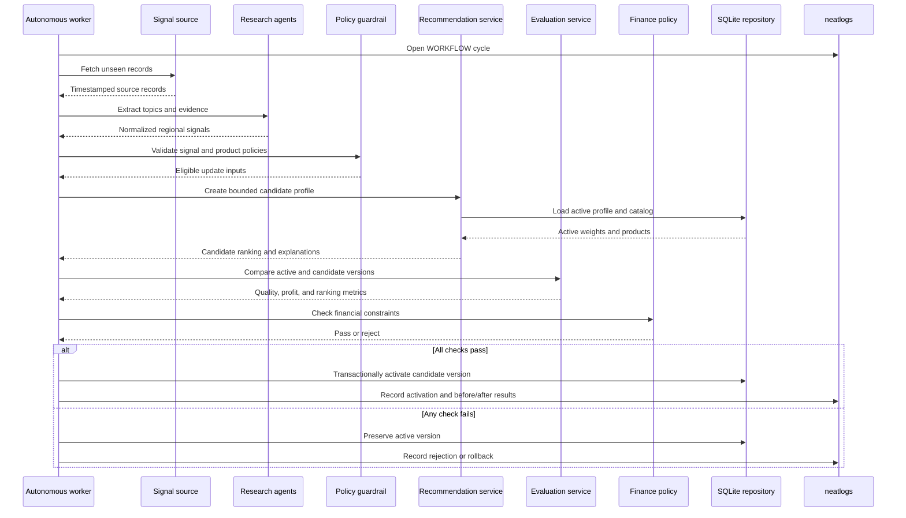
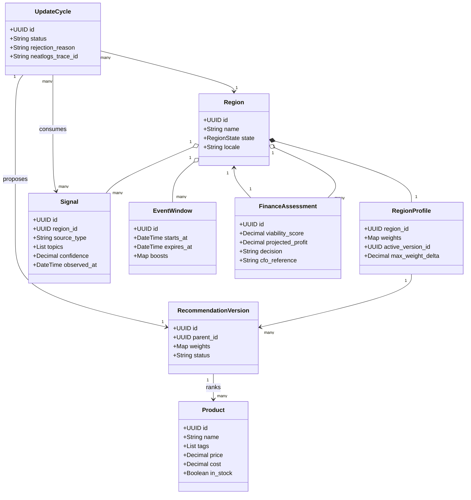

# Atlas Commerce Agent — Architecture

## Design principles

The system is a modular monolith with durable state and clear integration adapters. Domain decisions should be testable without a UI, LLM, or network connection. External integrations must report unavailable, degraded, or successful status explicitly.

The prototype uses a deterministic weighted ranker and synthetic streams. This gives us visible, repeatable recommendation changes while preserving extension points for real data and more advanced models later.

## High-level flow

```text
Streamlit dashboard
        |
Application services
        |
Region lifecycle service ---- Financial viability service ---- cfo.ai MCP
        |
Autonomous worker
        |
Signal ingestion → research/normalization → policy guardrail
        |                                      |
        +→ candidate weight update → evaluator → activation/rollback
        |
Recommendation service → product ranking → storefront preview
        |
SQLite state and version history
        |
neatlogs traces/evaluations       Entire development context/checkpoints
```

## Components

### Agent workflow runtime

Docker Compose can deploy a local HTTP coordinator and isolated same-model
specialists for planning, research, finance, deterministic recommendation review,
and plan review. Workers have no database mount or direct write route. The
coordinator validates structured output, checks each proposed operation against
the direct operator request, and persists an immutable plan. When a request both
creates a candidate and explicitly asks to cycle it, the plan may include activation
between those steps; the direct create-and-cycle request authorizes that activation
prerequisite, which still passes the deterministic finance gate. Authorization is tied
to the canonical plan hash. Workers can invoke only validated action IDs through the
coordinator's internal endpoint, which calls existing Atlas application services.
Permanent deletion requires explicit intent and a review card containing the
exact row snapshot and dependent-record counts; execution rechecks both in an
immediate SQLite transaction and retains an audit snapshot. The dashboard and
coordinator share the local SQLite volume and bind host ports only to localhost.

### Presentation layer

Streamlit provides the demo dashboard. It displays region states, finance assessments, signals, rankings, update proposals, and evidence. It calls application services and does not contain ranking or integration logic.

### Region lifecycle service

Responsibilities:

- register candidate regions;
- request viability assessment;
- store assessment results;
- activate a region after a direct request and passing finance gate, or reject it;
- pause, resume, or archive a region;
- expose the current lifecycle state.

### Autonomous worker

The worker runs a polling cycle over active regions. In demo mode, a button or accelerated clock triggers the same cycle. Each cycle is idempotent and records a cycle ID.

The worker must isolate failures by region. It processes only new signal IDs, skips stale or low-confidence evidence, and never replaces the active recommendation version until the candidate passes validation.

### Research and normalization agents

The agents read synthetic source records and produce structured `RegionalSignal` objects:

- source ID and source type;
- region ID;
- observed timestamp;
- extracted topics/tags;
- sentiment or demand direction;
- confidence;
- evidence excerpt;
- language and normalized text;
- event window when relevant.

The LLM is optional for fixture mode. The application must have a deterministic extractor so tests and the demo remain reproducible.

### Policy guardrail

The guardrail removes products that violate explicit product, inventory, regional, or campaign rules. It also checks that signals do not contain unsupported sensitive targeting assumptions.

### Recommendation service

The service loads the active `RegionProfile`, `Product` records, active events, and eligible policies. It computes scores, returns ranked products, and stores the score breakdown for explanation.

### Update and evaluation service

The update service creates a candidate profile from newly observed signals. It clamps changes, attaches evidence, and creates a candidate version. The evaluation service compares active and candidate profiles against the same simulated customer cohort and calculates relevance, conversion, contribution profit, policy violations, and ranking movement.

The candidate is activated only when it meets configured thresholds. Otherwise it is rejected and the active version remains unchanged.

The autonomous update is represented as a UML sequence model:



### Financial viability service

The service builds a structured regional assessment from traffic, conversion, order value, margin, fulfillment, campaign, and inference assumptions. It sends or exposes scenario inputs through the cfo.ai adapter, records the returned model/scenario references and outputs, and applies a local decision policy.

The local policy is needed for deterministic application behavior even when cfo.ai is unavailable. It must clearly indicate when it used a fallback calculation.

## Domain objects

- `Region`: identity, lifecycle state, locale, source availability, and timestamps.
- `RegionProfile`: region weights, policy version, active recommendation version, and update limits.
- `Product`: catalog metadata, tags, cost, price, stock, and eligibility.
- `Signal`: normalized evidence extracted from a source record.
- `EventWindow`: temporary topic boosts with start and expiry timestamps.
- `FinanceAssessment`: assumptions, scenarios, score, decision, and cfo.ai references.
- `RecommendationVersion`: immutable weight snapshot and parent version.
- `RecommendationItem`: product score and score breakdown for a version.
- `UpdateCycle`: input signal IDs, proposed changes, evaluation, result, and error state.
- `EvidenceReference`: neatlogs trace/evaluation, Entire checkpoint, or cfo.ai scenario reference.

The core domain relationships are represented as a UML class model:



## Persistence

SQLite is the source of truth for the prototype. Store immutable versions rather than overwriting weights. Use transactions for activation and rollback.

Suggested tables:

```text
regions
region_profiles
products
source_records
signals
event_windows
finance_assessments
recommendation_versions
recommendation_items
update_cycles
evidence_references
simulated_events
```

## Integration boundaries

### neatlogs adapter

Initialize once at process startup. Decorate the top-level cycle as a `WORKFLOW`; use `AGENT`, `TOOL`, `GUARDRAIL`, `RETRIEVER`, and `CHAIN` spans for the corresponding steps. Include region ID, cycle ID, model version, and result status as attributes. Capture failures, retries, latency, token usage, and evaluation results.

The adapter must support a local no-network mode for unit tests, but the demo must run with the real project key and produce inspectable traces.

### cfo.ai adapter

Provide operations for creating/reading a regional scenario and reading calculated outputs. Prefer the cfo.ai MCP server for the authenticated workspace. Preserve workspace, model, scenario, and page references in `EvidenceReference` records.

The adapter must expose `connected`, `degraded`, and `failed` states. Do not call a local fallback result a cfo.ai result.

### Entire evidence

Entire is a development integration. Use it with the repository and coding agent to inspect code context, create checkpoints for meaningful improvements, and generate `entire-graph` evidence where useful. The application may store a human-readable checkpoint URL or commit reference in the evidence table, but runtime recommendation updates remain application data.

## Extension points

The following interfaces should be small and replaceable:

- `SignalSource`: replace fixtures with RSS, news, forum, or approved API sources.
- `SignalExtractor`: replace deterministic extraction with multilingual LLM extraction.
- `RecommendationScorer`: replace weighted ranking with a learned model.
- `EvaluationStrategy`: replace the simulator with offline replay or A/B measurements.
- `FinanceProvider`: replace the prototype adapter with a verified cfo.ai MCP client.
- `Scheduler`: replace accelerated polling with a production job runner.
- `StateRepository`: replace SQLite with PostgreSQL when multi-user concurrency requires it.
