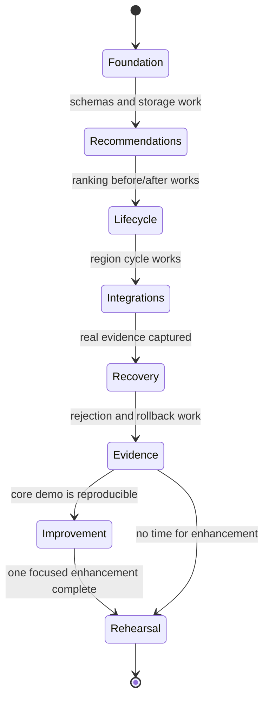

# Atlas Commerce Agent — Build Plan

## Build strategy

Build a complete vertical slice first: one candidate region, one approval, one autonomous update, one visible recommendation change, one failed update, and evidence from all three required products. Then use the remaining sprint time for one improvement that strengthens reliability or the demo.

The detailed team schedule is maintained in `SPRINT_PLAN.md`. It assigns Z, Ar, Ad, and S to four timestamped 90-minute sprints, with per-task branches, tests, acceptance checks, GitHub PR checklists, merge gates, and a reserved improvement window. Follow that plan for execution; the hour-by-hour outline below describes the dependency order.

The sprint is organized as a UML state machine so the team can see when it is safe to spend time on polish or future improvements:



Keep the implementation as a Python modular monolith. Use `uv` with a `pyproject.toml` and checked-in `uv.lock`. Use Streamlit for the dashboard, SQLite for state, Pydantic for schemas, and plain Python services for orchestration and ranking.

## Proposed repository layout

```text
atlas-commerce/
├── AGENTS.md
├── PRODUCT.md
├── ARCHITECTURE.md
├── INTEGRATIONS.md
├── BUILD_PLAN.md
├── SPRINT_PLAN.md
├── DEMO_AND_TESTS.md
├── .github/
│   └── pull_request_template.md
├── pyproject.toml
├── uv.lock
├── app.py
├── worker.py
├── src/adaptive_commerce/
│   ├── domain/
│   ├── application/
│   ├── agents/
│   ├── recommender/
│   ├── integrations/
│   ├── persistence/
│   └── presentation/
├── data/fixtures/
├── tests/
└── docs/evidence.md
```

## Six-hour core build

### Hour 1 — foundation

- create the uv project and dependency lock;
- define Pydantic domain models;
- create SQLite schema/repository;
- load products, regions, policies, and synthetic source records;
- add a basic Streamlit shell.

### Hour 2 — recommendations

- implement deterministic weighted scoring;
- implement score breakdowns;
- implement recommendation versions;
- show top-five products for each region;
- add the fixture that visibly changes product ranking after a festival signal.

### Hour 3 — lifecycle and autonomy

- implement candidate, assessment, approval, active, paused, and archived states;
- implement the autonomous worker cycle;
- implement idempotent signal ingestion;
- implement bounded weight updates and event expiry;
- implement candidate activation and rollback.

### Hour 4 — integrations

- instrument the full workflow with neatlogs;
- verify a real neatlogs trace and capture its ID;
- configure Entire and create a development checkpoint;
- connect cfo.ai MCP or verify the connection path;
- create the cfo.ai business model and regional scenario.

### Hour 5 — evaluation and recovery

- implement simulated impressions, clicks, orders, ratings, and profit;
- compare active and candidate versions on identical simulated users;
- add rejection and rollback behavior;
- record cfo.ai outputs and convert them into local financial policy;
- run the complete demo scenario.

### Hour 6 — evidence and polish

- improve the before/after recommendation view;
- show signal evidence and score explanations;
- display integration status and references;
- create `docs/evidence.md`;
- capture screenshots/traces/checkpoints;
- run tests and rehearse the demo.

## Reserved improvement time

After the core workflow works, choose exactly one improvement:

- add a second region and prove isolation;
- add a second event window and automatic expiry;
- add a neatlogs evaluation comparison;
- add a cfo.ai downside scenario gate;
- add a failure injection and automatic retry/rollback;
- add a second language fixture with deterministic translation fallback.

Do not begin an improvement until the core end-to-end scenario is reproducible.

## Future roadmap

### Near-term

- replace fixtures with authenticated feeds;
- add source trust and deduplication;
- use real cfo.ai model variables and scheduled scenarios;
- add richer offline recommendation evaluation;
- add inventory and product availability feeds;
- replace the local polling scheduler with a durable job store when the deployment model requires it.
- add real cfo.ai MCP reads and verified neatlogs trace retrieval once workspace access is configured.

### Later

- learn ranking weights from real interaction data;
- add multilingual embedding and retrieval;
- add controlled A/B experiments;
- move from SQLite to PostgreSQL;
- add authentication and tenant isolation;
- deploy workers separately from the dashboard;
- add automated model monitoring and drift detection.

## Scope rules

If the build falls behind, preserve this order:

1. product ranking before/after change;
2. region lifecycle and autonomous cycle;
3. neatlogs trace;
4. cfo.ai model/scenario evidence;
5. Entire checkpoint evidence;
6. UI polish and optional improvements.

Never remove the three integration roles from the core design. Reduce data realism or UI complexity first.
