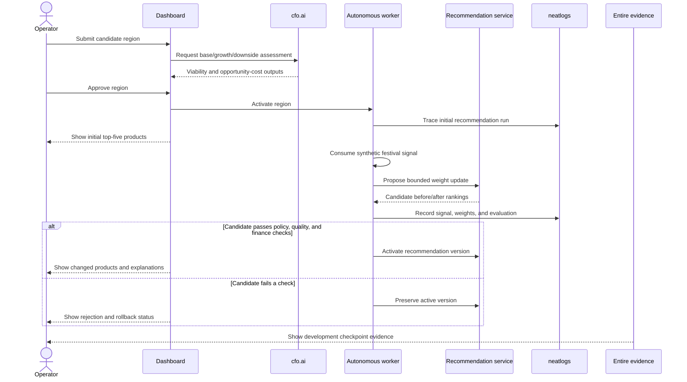
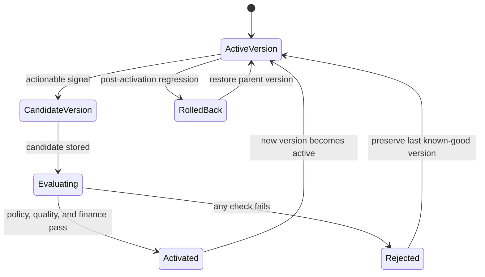

# Atlas Commerce Agent — Demo and Test Plan

## Demonstration story

### Specialist workflow demo

Run `docker compose up --build` with an OpenRouter key in `.env`. In **Agent
workflows**, submit “Add a festival signal to Cedar Valley at confidence 0.91, run
its regional cycle, and report the recommendation changes.” Watch the planner,
research, finance, recommendation, and review duties update. While specialists are working, confirm the planned signal and cycle are visible.
After request validation, confirm the signal, cycle result, deterministic before/after ranking, and
simulated evaluation. Ask “Don’t run a regional cycle for Cedar; tell me its
pending signals” as a read-only control; this must not start a workflow or consume
signals.

The same chained request can be sent from **Ask Atlas**. It remains in the chat
and the assistant reply includes **Open agent workflow**, which opens the saved
plan and specialist review. Read-only questions and single operations stay in
the ordinary assistant. For provider delays, allow up to about two minutes for
a specialist duty before treating it as timed out; inspect the worker logs with
the command below.

For a new-region chained workflow, the proposed action order must show candidate
creation, activation, signal addition, and then the regional cycle. The direct
create-and-cycle request authorizes that exact activation prerequisite, while Atlas
still applies its finance gate before any signal or cycle can run.
If finance rejects the candidate, execution stops at activation and later actions
remain unexecuted. The current region model has no description field, and catalog
eligibility is shared globally; the plan summary must disclose these limitations
instead of claiming to save a description or apply a region-only product filter.

For permanent deletion, use a disposable database. Request permanent deletion of
one exact synthetic signal or product, inspect the target snapshot and dependency
counts, then verify the target is gone and the audit snapshot remains.
A request that only says “delete” must not generate a hard-delete operation. Never
use a production database for this scenario. API key configuration proves only
configuration; a successful planning task verifies actual model availability.
cfo.ai remains degraded until a live authenticated scenario is demonstrated.

Use fictional regions and products so the result is reproducible and safe to share.

The main demo is a UML sequence model:



### Scenario A — region evaluation and activation

1. Open the dashboard with two active regions and one candidate region.
2. Submit the candidate region with traffic, conversion, margin, campaign cost, and data-availability assumptions.
3. Run the financial assessment.
4. Show cfo.ai base, growth, and downside scenarios.
5. Show the viability score, expected profit, and opportunity cost.
6. Approve the region.
7. Show the region entering `active` with a default recommendation profile.
8. Pause and resume the region, then confirm paused regions are skipped by worker runs.

### Scenario B — autonomous update changes products

1. Display the region's current top-five products.
2. Inject a timestamped synthetic festival signal.
3. Run the autonomous cycle.
4. Show research output, normalized topics, confidence, and evidence.
5. Show the old and candidate weights.
6. Show products promoted and demoted.
7. Show the new top-five products in the storefront preview.
8. Show the neatlogs trace containing the cycle and recommendation update.
9. Roll back to the parent version and show the active top five returning to its prior state.

After a signal is consumed, the dashboard shows zero pending signals and disables
the one-region run button. Add fresh synthetic evidence before starting another
cycle. A no-signal cycle is a no-op, not a successful recommendation update.

### Confidence sensitivity check

Use Aspen Ridge so the Cedar fixture signal is not mixed into the experiment.
Reset before each trial, submit one `festival` signal with the same evidence,
and compare confidence `0.65`, `0.70`, and `0.80`. The first is rejected by the
confidence gate, `0.70` should activate and bring LED String Lights into the
top five, and `0.80` should propose a larger change that the simulated profit
guardrail rejects. Identical synthetic submissions reuse one source ID; change
the evidence excerpt when you intend to add a genuinely separate observation.

### Scenario C — rejected update and recovery

1. Inject a low-confidence or low-margin signal.
2. Run the autonomous cycle.
3. Show that the candidate version fails a finance, quality, or policy check.
4. Keep the active recommendation version unchanged.
5. Show the rejection in the UI and neatlogs.
6. Confirm that the next cycle can continue.

### Scenario E — operator replay and reset

1. Select a saved cycle from Activity & evidence and replay its exact signal IDs.
2. Confirm replay creates a new cycle record and leaves prior history intact.
3. Reset the workspace from Settings and confirm fixtures restore the initial state.

The update outcome is a UML state model:



### Scenario D — Entire development evidence

Show:

- the project `AGENTS.md` and planning documents supplied to the coding agent;
- repository graph/context output where available;
- a checkpoint for the first implementation;
- a later checkpoint tied to a fix or improvement;
- the commit or checkpoint references in `docs/evidence.md`.

## Manual verification checklist

- A new region cannot become active without a direct activation request and a passing finance gate.
- An already active region can process a routine update without approval.
- A duplicate source record is processed only once.
- A stale event does not produce a new update.
- A temporary event boost expires.
- A disallowed product never appears in the final ranking.
- An out-of-stock product never appears in the final ranking.
- A candidate update cannot exceed the configured weight-change limit.
- A failed evaluation leaves the active version unchanged.
- A failed region cycle does not prevent another region from running.
- Recommendation score breakdowns explain before/after rank movement.
- Simulated sales use the same customer cohort for active and candidate comparisons.
- A cfo.ai outage is shown as degraded/fallback, not falsely reported as success.
- Missing neatlogs credentials make integration status explicit.
- A paused or archived region is never processed by the all-region worker.
- A replay creates a new cycle and keeps the source cycle immutable.
- Reset clears local operator history and restores the checked-in fixture set.
- All secrets are absent from source, fixtures, logs, and evidence.

## Focused automated tests

Use `pytest` tests with names such as:

```text
test_candidate_region_requires_approval
test_active_region_runs_autonomous_cycle
test_duplicate_signal_is_idempotent
test_event_boost_expires
test_recommendation_ranking_changes_after_signal
test_policy_excluded_product_is_not_recommended
test_out_of_stock_product_is_not_recommended
test_weight_update_is_bounded
test_failed_evaluation_preserves_active_version
test_region_failure_does_not_stop_other_regions
test_finance_policy_rejects_low_margin_campaign
test_cfo_unavailable_is_reported_as_degraded
test_neatlogs_trace_context_contains_region_and_cycle
```

## Required before/after evidence

For the primary update, record:

- region ID;
- active version ID;
- candidate version ID;
- input signal IDs;
- old weights and new weights;
- old top-five products;
- new top-five products;
- promoted/demoted products;
- confidence and evidence excerpts;
- active/candidate conversion and contribution-profit metrics;
- neatlogs trace/evaluation reference;
- cfo.ai scenario/reference when finance influenced the decision.

## Demo timing

Target a three-minute recording:

- 0:00–0:25 — problem and candidate region;
- 0:25–0:55 — cfo.ai financial assessment and human approval;
- 0:55–1:45 — autonomous signal cycle and changing products;
- 1:45–2:15 — neatlogs trace and before/after metrics;
- 2:15–2:40 — rejected update and rollback;
- 2:40–3:00 — Entire checkpoint and explanation of the three integrations.

## Validation commands

Once the project is implemented, run commands similar to:

```bash
uv sync
uv run pytest
uv run python -m compileall src tests app.py worker.py
uv run streamlit run app.py
uv run python worker.py --once
```

Record the exact commands and results in the project README before submission.
