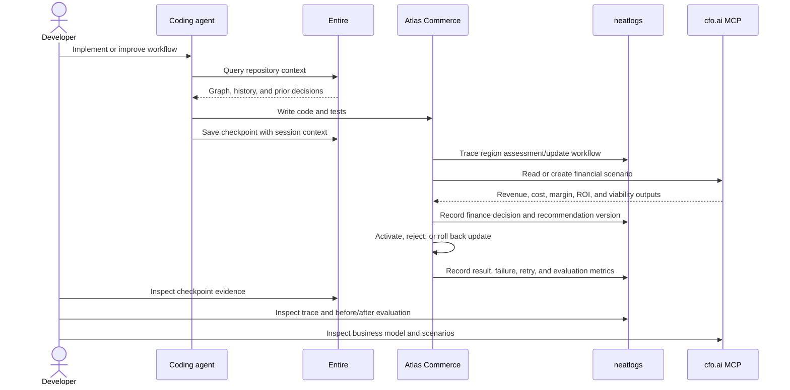

# Atlas Commerce Agent — Integration Contract

The hackathon requires meaningful use of neatlogs, Entire, and cfo.ai. This document defines what counts as implementation and what evidence must be captured.

## Integration interaction model

The following UML sequence shows how the application uses all three products across development, runtime, and business planning:



## neatlogs

### Role

neatlogs is the runtime observability and evaluation layer. It must show how an autonomous cycle worked, what changed, whether it failed, and whether a fix improved the result.

### Required implementation

- initialize the Python SDK once;
- wrap the LLM client when an LLM is used;
- trace the top-level region update workflow;
- trace each research agent and tool call;
- trace source ingestion, policy guardrails, ranking, evaluation, and activation;
- attach region ID, cycle ID, recommendation version, and result status;
- record errors and bounded retries;
- record evaluation metrics for active versus candidate versions;
- query or link the relevant trace/evaluation in the dashboard.

### Required evidence

Capture:

1. a successful candidate-region assessment cycle;
2. a successful autonomous update cycle where recommendations change;
3. a failed or rejected update showing what the system did next;
4. before/after evaluation values;
5. trace IDs or screenshots for the demo and repository.

The neatlogs Python SDK supports custom spans for workflows, agents, tools, guardrails, and retrieval steps. Its public API can read traces and automate workflows when the project has suitable credentials and access. Verify the authenticated connection before building logic that depends on API reads. [Python SDK](https://docs.neatlogs.com/sdk/python) · [Public API](https://docs.neatlogs.com/api-reference)

### Assistant behavior

The Atlas Assistant uses an OpenAI-compatible provider adapter. OpenRouter is
the default (`openrouter/free`), which routes to an eligible free model; set `LLM_PROVIDER=openai`,
`OPENAI_API_KEY`, and `LLM_MODEL` to switch to the official OpenAI endpoint.
Tool calls are allowlisted and bounded. Read tools expose Atlas snapshots,
sanitized trace summaries, and deterministic recommendation previews. Region
activation and version changes remain outside chat. On an explicit correction
request, the assistant can append a corrected signal only after exact trace
readback; the original signal and a correction audit row remain durable. The
dashboard discloses that queried Atlas records may be sent to the configured
model provider. Prompt and model response content are masked from Neatlogs
export, while span metadata, error types, and status remain available.

Trace readback requires `NEATLOGS_PROJECT_ID` and `NEATLOGS_TOKEN` in addition
to export configuration. If these are absent or the exact trace cannot be
retrieved, trace inspection and correction report a degraded/failed status and
correction writes are refused.

## Entire

### Role

Entire supplies repository context and records coding-agent work. It is a development and change-history integration for this project.

### Required implementation

- install/configure Entire for the project repository;
- use repository context or `entire-graph` while implementing the orchestrator and integrations;
- keep this `AGENTS.md` and the planning documents available to the coding agent;
- create a checkpoint after the core workflow is implemented;
- create a second checkpoint after an evidence-backed improvement or failure recovery fix;
- record the checkpoint/commit references in the submission evidence.

The application must not claim that ordinary runtime weight updates are Entire code changes. Runtime profiles are versioned in SQLite; code or agent-instruction changes are captured by Entire.

Entire describes checkpoints as code changes paired with the prompt, reasoning, and tool calls behind them, and provides repository/session search and semantic graph context. [Entire documentation](https://docs.entire.io/)

## cfo.ai

### Role

cfo.ai is the business and financial model layer. It determines whether opening a region is economically worthwhile and models the business around the agent.

### Required implementation

Create a cfo.ai model with:

- active regions and candidate regions;
- monthly or weekly traffic;
- conversion rate;
- average order value;
- product and fulfillment costs;
- inference and infrastructure cost;
- customer acquisition or campaign cost;
- revenue, gross profit, gross margin, and runway;
- base, growth, and downside scenarios;
- regional opportunity cost;
- product or campaign ROI.

The application should submit or read a regional scenario through the cfo.ai MCP connection where access is available. It must store references to the model and scenario, display the returned outputs, and convert approved thresholds into a local `FinancePolicy` used by the activation and ranking services.

The current runtime has no authenticated cfo.ai MCP client. Finance remains
behind the cfo adapter boundary and uses a clearly labeled local simulation
until an authenticated model/scenario read is implemented and verified. An
operator-supplied export is validated and retained as unverified provenance; it
does not silently become the finance engine result. The natural-language
assistant reports that provenance and does not treat imported numbers as live
cfo.ai outputs.

If MCP authentication or an operation is unavailable, the UI must state `cfo.ai unavailable` and show that the assessment is a local fallback. The demo may continue, but the cfo.ai integration is not considered complete until a real model/scenario read is verified.

cfo.ai documents a remote MCP server at `https://api.cfo.ai/mcp` that can inspect and, with authorization, modify models, scenarios, variables, pages, and formulas. Its scenario workflow supports alternative plans while keeping the main model unchanged. [MCP setup](https://docs.cfo.ai/integrations/mcp-server) · [Scenario documentation](https://docs.cfo.ai/scenarios/create-and-compare-scenarios)

### Required evidence

- cfo.ai model link or workspace reference;
- regional viability scenario;
- base/growth/downside comparison;
- business plan for pricing, costs, revenue, and runway;
- screenshot or export of the financial outputs used by the demo;
- mapping from cfo.ai outputs to the application's activation policy.

## Evidence manifest

Create `docs/evidence.md` during implementation with:

```text
neatlogs project:
neatlogs successful trace:
neatlogs failed/rejected trace:
neatlogs evaluation:
Entire repository/checkpoint:
Entire graph output:
cfo.ai workspace/model:
cfo.ai scenario:
cfo.ai business plan:
```

Do not put secrets or private customer data in the evidence manifest.
