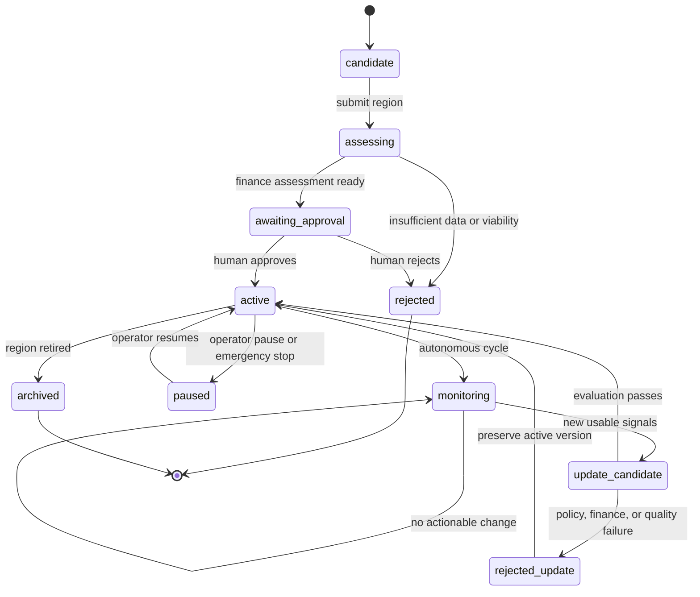
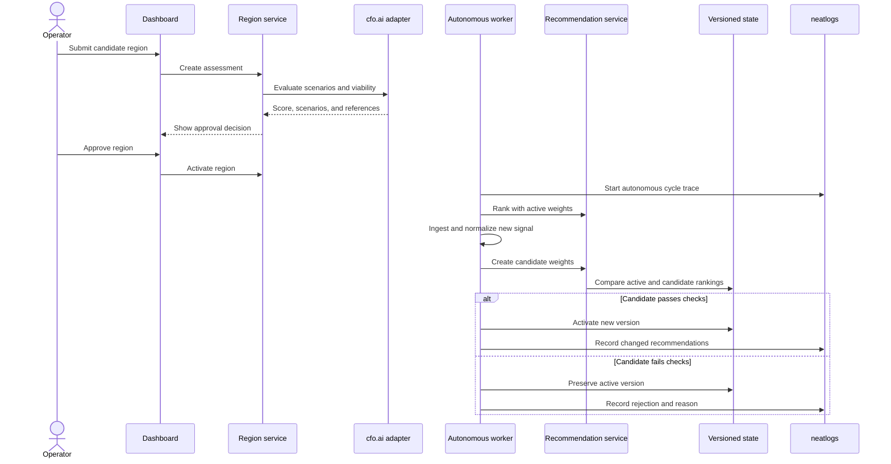

# Atlas Commerce Agent — Product Definition

## Product statement

Atlas Commerce is an autonomous regional expansion and recommendation system. It evaluates whether a new region is financially worth serving, waits for human approval to activate it, and then adapts that region's product recommendations as new regional signals arrive.

The prototype uses synthetic data streams and a simulated storefront. It demonstrates the control loop that could later consume real commerce, news, event, and community data.

## User and primary workflow

The primary user is a commerce operator or product manager.

The user submits a candidate region with a name, market assumptions, and an optional event or launch context. The system gathers the region's available signals, estimates financial viability, and presents a recommendation to approve or reject activation.

After approval, the region enters an active state. The autonomous worker periodically processes new signals, proposes a bounded weight update, validates its effect on recommendations and simulated economics, and activates or rejects the update. The user does not need to approve routine weight updates, but can pause a region or restore an earlier version.

## What the user should see

The dashboard should make the following visible:

- candidate and active regions;
- financial viability score and supporting assumptions;
- current region profile and active recommendation version;
- incoming signals and their evidence;
- product recommendations before and after an update;
- products promoted, demoted, added, and removed;
- explanation for each score change;
- update status, confidence, and rollback status;
- neatlogs trace/evaluation links or IDs;
- Entire checkpoint/evidence references;
- cfo.ai scenario and model references.

## Recommendation behavior

The catalog contains products with tags, price, cost, stock, base popularity, and policy eligibility. A region has weights for interests such as `outdoor`, `travel`, `festival`, and `electronics`.

The initial ranker is deterministic:

```text
score = base_popularity
      + regional_interest_match
      + temporary_event_boost
      + margin_bonus
      - policy_penalty
```

LLM agents may extract normalized signals from text, but a deterministic scorer produces the final ranking. Weight changes are bounded, versioned, and reversible.

The demo must show a clear ranking change. For example, a region initially recommends hiking products; a new festival signal increases festival and electronics weights; portable chargers, phone pouches, and festival accessories move into the top five.

## Region lifecycle

```text
candidate → assessing → awaiting_approval → active
                                      ↘ rejected
active → monitoring → update_candidate → active
                              ↘ rejected/rolled_back
active → paused → active
active → archived
```

Only activation of a new region requires human approval. The system can autonomously process routine updates for active regions. A global pause and a per-region pause remain available for recovery.

The lifecycle is represented as a UML state machine:



The primary user interaction and autonomous update are shown below as a UML sequence model:



## Safety and quality boundaries

- Use explicit product and regional exclusion policies.
- Do not infer sensitive customer or political attributes.
- Require sufficient signal confidence and minimum evidence before an update.
- Clamp weight changes and limit the number of changes per cycle.
- Expire temporary event boosts automatically.
- Do not recommend unavailable or disallowed products.
- Reject an update when its evaluation is worse than the active version.
- Preserve the last known-good version.
- Label all synthetic data and simulated business results in the UI and demo.

## Hackathon scope

### Included in the prototype

- one shared synthetic product catalog;
- two already active regions;
- one candidate region;
- synthetic news, forum, social, and event streams;
- financial viability assessment;
- human region activation;
- autonomous signal processing and bounded weight updates;
- before/after product recommendations;
- simulated impressions, clicks, orders, ratings, and profit;
- neatlogs runtime traces and evaluations;
- Entire development checkpoints and repository context evidence;
- cfo.ai business model and regional scenarios;
- failure, rejection, and rollback demonstrations.

### Deferred for later improvements

- production feeds and source authentication;
- real multilingual translation and source credibility models;
- collaborative or neural recommendation models;
- real A/B experimentation and causal measurement;
- inventory, payments, fulfillment, and return integrations;
- distributed workers and production deployment;
- automated code changes generated at runtime;
- identity, access control, and multi-tenant administration;
- model training pipelines and feature stores.

## Success criteria

The prototype succeeds when a reviewer can start with a candidate region, understand its financial decision, approve it, run an autonomous data cycle, see its top products change, inspect why they changed, observe the run in neatlogs, verify the development history through Entire, and inspect the financial assumptions in cfo.ai.
