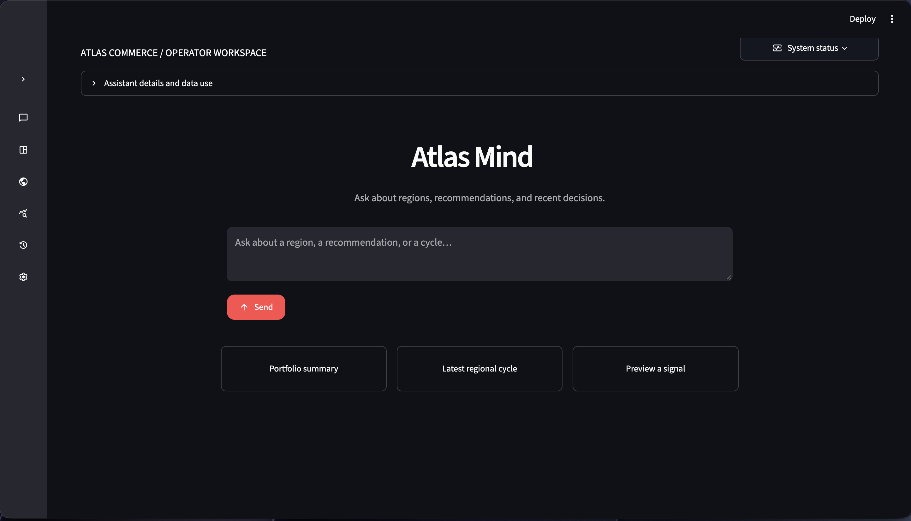

# Atlas Commerce



Atlas Commerce is a local operator workspace and a full, orchestrator agent for evaluating candidate regions, approving viable markets, and safely adapting regional product recommendations from synthetic signals. Financial and evaluation outcomes are simulated. External signal providers remain replaceable adapters, and partner integrations show explicit degraded status unless live operations are verified.

## How it works

1. An operator submits a candidate region and reviews its simulated base/growth/downside assessment.
2. The operator requests activation or rejection; activation creates the first durable recommendation version only when the finance gate passes.
3. The operator injects synthetic evidence or processes unseen signals through a deterministic, bounded update cycle.
4. Candidate and active recommendations are compared on the same simulated cohort; passing updates activate transactionally, while rejected or failed cycles preserve the active version.
5. Operators can pause, resume, archive, rollback, inspect cycle history, replay a cycle, and reset the local demo.

## Architecture

The planned implementation is a Python modular monolith: Streamlit presentation calls application services; domain, ranking, and integration logic stay outside the UI. SQLite stores durable state and immutable recommendation versions. External services are accessed through small adapters and must expose clear success, degraded, or failed status.

```text
Streamlit dashboard → application services → region lifecycle / finance
                   → autonomous worker → signals → policy checks
                                         → candidate ranking → evaluation
                                         → activate or reject
                   → recommendation service → storefront preview
                   → SQLite state/version history

neatlogs: runtime traces and evaluations
Entire: development context and checkpoints
cfo.ai: financial model and regional scenarios
```

The main domain concepts are `Region`, `RegionProfile`, `Product`, `Signal`, `EventWindow`, `FinanceAssessment`, `RecommendationVersion`, `RecommendationItem`, `UpdateCycle`, and `EvidenceReference`. SQLite is the prototype source of truth; activation and rollback must be transactional.

## Recommendation and safety rules

The initial ranker is deterministic and explainable:

```text
score = base popularity + regional interest match + temporary event boost
        + margin bonus - policy penalty
```

LLMs may extract or translate signals and explain decisions, but they do not choose final ranking scores. Weight changes are bounded, versioned, and reversible. Work is idempotent by source/region/event/cycle identifiers; stale or low-confidence signals do not trigger updates, and temporary event boosts expire.

Explicit product, inventory, regional, and campaign policies exclude unsafe or unavailable products. Do not infer sensitive attributes. A failed region cycle must not stop other regions. Network calls need explicit timeouts and bounded retries. Preserve the active version unless a candidate passes validation. Use synthetic fixtures and label simulated results. Keep secrets and private data out of source, fixtures, logs, and evidence.

## Integrations

- **neatlogs** is runtime observability: trace the full assessment/update workflow, research and tool calls, guardrails, ranking, evaluation, activation, failures, and retries. Include region, cycle, version, and result context. Tests can use local no-network mode; the demo should produce real inspectable traces when credentials are available.
- **Entire** is development evidence, not runtime recommendation storage. Use repository context/`entire-graph` and capture checkpoints for meaningful code changes. Runtime profiles remain versioned application data in SQLite.
- **cfo.ai** provides financial models and regional scenarios covering traffic, conversion, order value, product/fulfillment and infrastructure costs, campaign spend, revenue, gross profit/margin, runway, opportunity cost, and ROI. Preserve model/scenario provenance. Never present a fallback calculation as a cfo.ai result.

If an integration is unavailable, document the exact limitation and show degraded status rather than claiming it succeeded. Store non-secret references and evidence in `docs/evidence.md` when created.

## Development

Requirements: Python 3.11 or 3.12 and `uv`. Dependencies and pytest configuration are in `pyproject.toml`; `uv.lock` is checked in.

```bash
uv sync
uv run pytest
```

Available demo checks are:

```bash
uv run python -m compileall src tests app.py worker.py
uv run streamlit run app.py
```

The app includes validated domain models, SQLite seeding and CRUD, lossless
Decimal storage, deterministic ranking, candidate approval, bounded signal
proposals, transactional activation/rollback, same-cohort simulated evaluation,
cycle history, replay, and region-isolated retries. The Streamlit dashboard
provides the operator controls and before/after storefront views. A local polling
worker is available for scheduled runs.

The dashboard opens to a composer-first Atlas Assistant. A labeled sidebar links
to Overview, Region operations, Recommendations, Activity & evidence, and
Settings, and can collapse to an icon rail. The visual system follows Streamlit's
active light or dark theme, uses restrained transitions, and honors reduced-motion
preferences.

Run the shell with `uv run streamlit run app.py`. Run one worker pass with
`uv run python worker.py --once`, or start local polling with
`uv run python worker.py --interval 300`. Set `ATLAS_DB_PATH` to use a different
SQLite file. Tests use temporary databases and do not need credentials.
Put `NEATLOGS_API_KEY` in the ignored repository `.env` file or export it in the
shell; the app loads `.env` automatically and shell values take precedence.
Without a key, the UI reports local-only tracing. Verify authenticated delivery
with `uv run python -m neatlogs doctor --probe --json`. To read a specific trace
from the CLI, also set `NEATLOGS_PROJECT_ID` and `NEATLOGS_TOKEN`; these are
readback credentials and must never be committed. See [`docs/evidence.md`](docs/evidence.md)
for the latest probe and Atlas workflow trace evidence.

cfo.ai is currently degraded, with deterministic local simulation. The model
includes revenue, product/fulfillment costs, campaign/inference/infrastructure
costs, margin, campaign ROI, cash runway, and opportunity cost. Base/growth/downside
vary traffic by 1 / 1.25 / 0.75. Set `CFO_SCENARIO_PATH` to an operator-supplied
JSON export matching `CfoScenarioImport` to inspect provider outputs/provenance;
imported data is explicitly unverified and does not replace the local decision.
No live cfo.ai success is claimed. The UI shows all financial assumptions.

### Atlas Assistant and model providers

Copy `.env.example` to `.env` and set `OPENROUTER_API_KEY`. The default model is
`openrouter/free`, which selects a free model that supports the requested
features such as tool calling; set `LLM_MODEL` to a specific OpenRouter
model ID to change it. To use the official OpenAI endpoint instead, set
`LLM_PROVIDER=openai`, provide `OPENAI_API_KEY`, and set `LLM_MODEL` to the
account's model. Both use the official OpenAI-compatible Python SDK and
Neatlogs instrumentation. The assistant can inspect Atlas data and the product
catalog, preview recommendation changes through the deterministic ranker and
evaluation gate, and inspect sanitized cycle trace metadata. Read-only questions
and single explicit operations stay on the existing assistant path. Chained
requests and requests containing multiple write operations go to the specialist
workflow. The direct request authorizes validated, allowlisted operations without a second approval click. Operations include candidate create/update/removal, lifecycle changes,
synthetic signal add/remove/repair, regional cycles and replay, catalog
create/update/removal, and explicitly requested hard deletion. Each proposed
operation is rechecked against positive intent in the current user message;
negated and hypothetical requests cannot trigger mutations.
Candidate activation still uses the finance gate; recommendation versions change
only through the deterministic cycle or rollback. Saved-version comparisons use
active event windows and policy at one shared evaluation time. Product and region removals
preserve history. A specifically requested signal correction requires exact cycle
trace readback and creates a new audited signal while retaining the original.
Imperative multi-step wording such as “setup a region, add confidence inputs,
cycle them, and compare results” also opens a reviewable workflow, even when
the request uses terms that do not exactly match a tool name. A chat-started
workflow remains linked from its assistant reply through **Open agent workflow**. Short affirmative replies after an assistant confirmation question continue the preceding chained request rather than being sent as an isolated tool query.
If the model emits internal-style deliberation instead of a user-facing answer,
the assistant suppresses it and returns a grounded response or a concise retry
request.

For trace-guided signal correction, also configure `NEATLOGS_PROJECT_ID` and
`NEATLOGS_TOKEN` for trace readback. A correction is stored as a new signal with
an audit record; the original remains intact. Neatlogs masking redacts prompts
and model response content before export. The dashboard discloses that relevant
Atlas records may be sent to OpenRouter. Free model endpoints can be rate limited.
See [docs/evidence.md](docs/evidence.md) for live verification state.

### Multi-agent workflows

Docker Compose deploys planner, research, finance, recommendation, and review
specialists as separate local worker containers. All workers share the selected
`LLM_PROVIDER` and `LLM_MODEL`. They propose structured application operations;
Atlas checks that each operation matches the operator request and saves the full
plan. The direct operator request authorizes its validated, allowlisted operations;
no second approval click is required. Requested work runs through existing Atlas
application services and the deterministic engine. Permanent deletion requires an explicit
permanent-delete request, shows the target snapshot and dependent-record counts,
rechecks both before removal, and retains an audit snapshot.
Free OpenRouter routes can be slow; `LLM_TIMEOUT_SECONDS` defaults to 90 seconds
and the coordinator allows a bounded 100-second worker response. The workflow
page shows each executed cycle's status, rejection reason, before/after rankings,
and simulated evaluation. Candidate regions remain inactive until a directly requested activation passes
the deterministic finance gate; a pending candidate cannot run cycles.

Run the dashboard, coordinator, and five workers locally:

```bash
cp .env.example .env
# Add OPENROUTER_API_KEY and optionally NEATLOGS_API_KEY to .env
docker compose up --build
```

Open <http://localhost:8501>. Use **Agent workflows** or ask Atlas to perform an
operation. Example: “Add a festival signal to Cedar Valley at confidence 0.91,
run its regional cycle, and report the recommendation changes.” Review specialist
findings and each operation while it runs. Use this command for local diagnostics:

```bash
docker compose logs -f orchestrator planner-agent research-agent finance-agent recommendation-agent review-agent
```

The internal token is only for the isolated
Compose network; change `ATLAS_INTERNAL_TOKEN` before a shared deployment. The
dashboard and API bind to localhost; this prototype is not an internet-facing,
multi-user service. `docker compose down` preserves the named SQLite volume;
`docker compose down -v` removes its database and workflow history.

The finance specialist reviews Atlas finance records and provider status; deploying
it does not establish a live cfo.ai connection. cfo.ai remains degraded until an
authenticated model/scenario operation is verified. Neatlogs export is enabled
with `NEATLOGS_API_KEY`, while live trace readback additionally needs project and
token credentials. Entire remains development evidence, not a runtime worker.

See [`docs/evidence.md`](docs/evidence.md) for actual checks and integration
blockers and [`SPRINT_PLAN.md`](SPRINT_PLAN.md) for the recovery ownership
exception, task branches, and merge gates. Product details remain in
[`PRODUCT.md`](PRODUCT.md), [`ARCHITECTURE.md`](ARCHITECTURE.md),
[`INTEGRATIONS.md`](INTEGRATIONS.md), [`BUILD_PLAN.md`](BUILD_PLAN.md), and
[`DEMO_AND_TESTS.md`](DEMO_AND_TESTS.md).

## Demo acceptance scenarios

1. Assess and human-approve a candidate region.
2. Run a synthetic festival signal and visibly change the target region's top-five recommendations, with explanations and trace evidence.
3. Run a low-confidence/low-margin signal, reject it, preserve the active version, and continue processing other regions.

Also verify duplicate-signal idempotency, event expiry, product/policy exclusions, bounded changes, rollback, same-cohort evaluation, and explicit degraded integration states. Keep the demo reproducible and label all simulated sales and evaluations.

## Team workflow

Follow `SPRINT_PLAN.md` for ownership and task branches. Keep branches focused, open a PR to `main`, and include exact test commands/results, relevant screenshots or integration references, and limitations using `.github/pull_request_template.md`. Do not push directly to shared `main` or force-push shared branches. Task owners report their own PR evidence; S coordinates integration and updates central sprint status only after checking PRs and required checks.
